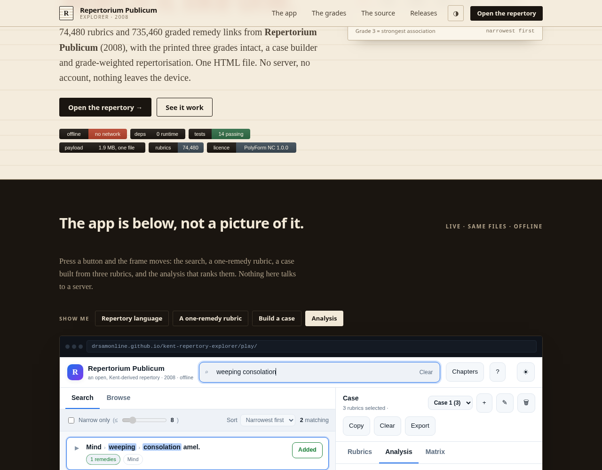
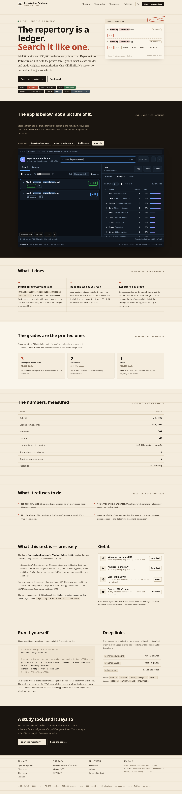
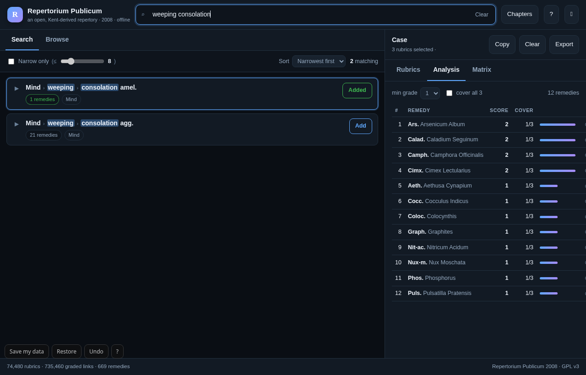

# Repertorium Publicum Explorer


**A repertory you can search like a ledger.** 74,480 rubrics and 735,460 graded remedy links from
**Repertorium Publicum** (2008) — the printed three grades intact, a case builder, and grade-weighted
repertorisation — in one HTML file that runs with no server, no account and no network.

**[Open the repertory →](https://drsamonline.github.io/kent-repertory-explorer/play/index.html)** ·
[the landing page](https://drsamonline.github.io/kent-repertory-explorer/) ·
[the data](https://github.com/drsamonline/homoeopathic-materia-medica-repertory-json) ·
[the source](pipeline/)

<!-- shot:start -->



<!-- shot:end -->

---

## What it is, precisely

The data is **Repertorium Publicum** by **Vladimir Polony (2008)**, published as part of the
[OpenRep](https://github.com/nondeterministic/oorep) source code and licensed **GPL v3**.

It is **not** Kent's *Repertory of the Homoeopathic Materia Medica*, 1897 first edition. It has its
own chapter structure — separate *Clinical*, *Appetite*, *Blood* and *Heart & Circulation* chapters,
which Kent does not have — and its own additions. Earlier releases of this app described it as Kent
1897; that was wrong, and it has been corrected throughout: this README, the page, the app's own
footer and both manifests.

## What's inside

| | |
|---|---|
| Rubrics | **74,480** |
| Graded remedy links | **735,460** |
| Remedies | **669** |
| Chapters | **41** |
| The whole app | **one 1.9 MB HTML file** (gzip + base64, decompressed in the browser) |

Every link carries a grade, taken from the typography of the printed repertory:

| grade | meaning | links |
|---|---|---|
| **3** | strongest association | 71,582 |
| *2* | moderate | 198,591 |
| 1 | least | 465,287 |

## Features

- **Search in repertory language** — `anxiety night`, `thirstless`, `weeping consolation`. Results
  are ranked **narrowest first**, because the rubrics with three remedies are the ones that narrow a case.
- **Chapter browse** across all 41 chapters, with rubric counts.
- **Filters** — narrow-only with an adjustable threshold, sort by narrowest / broadest / A–Z / chapter.
- **Named cases** — keep several at once: switch, rename, delete. Each holds its own rubrics and notes.
- **Case builder** — add rubrics, attach a note to each, remove or clear. **Undo/redo** with `Ctrl+Z`.
- **Analysis** — remedies ranked by the sum of grades and rubrics covered; minimum-grade filter;
  "cover all rubrics"; exclude a remedy (it stays visible, struck through, and can be brought back).
- **Matrix** — remedy × rubric grid showing each grade.
- **Why a remedy ranks** — click it in the analysis to see every rubric of *this* case it covers, at
  which grade, and which it misses.
- **Remedy → rubrics** — click any remedy chip to see every rubric it appears in, by chapter and grade.
- **Chapter drill-down** — browse a chapter, then its branches, then search inside one.
- **"Did you mean"** — a spelling that finds nothing is matched against the repertory's own vocabulary.
- **Export** — plain text, CSV, JSON, copy to clipboard, and a clean print/PDF sheet.
- **Deep links** — `#q=anxiety+night`, `#tab=analysis`, `#demo=case`, `#remedy=Ars`, `#rubric=<id>`.
  No router, no dependency; this is what drives the live demo on the landing page.
- **Themes** — dark, light, high-contrast. **Keyboard-first** with `/`, `↑ ↓`, `Enter`, `c`, `a`, `m`, `t`, `Esc`.
- **Offline-first** — one self-contained HTML file, a manifest at the right path and a service worker
  that precaches the app and serves the HTML network-first, so a release lands on the next visit. The
  header says `Offline ready` once the app is cached, and offers `New version — reload` when one lands.
- **A print sheet that is the case** — rubrics, notes, analysis and matrix, without the interface.
- **A build stamp in the footer**, so "am I on the new one?" is answerable from inside the app.
- **Case persists** in local storage; notes included.

## Using it

1. Search in **repertory language** — not the patient's words.
2. Prefer **narrow** rubrics; a rubric with 250 remedies tells you little, one with three is gold.
3. **Add** the rubrics that survive to your case.
4. Open **Analysis** to rank remedies across them.
5. Treat the ranking as a **shortlist to study in the materia medica** — the repertory narrows, the materia medica decides.

## Screenshots

| landing page | the app |
|---|---|
|  |  |

Both are taken from the real pages by `scripts/shot.sh` — headless Chromium, no mock-ups. The app
shot opens a deep link (`#demo=analysis`) so it shows a populated screen instead of an empty search box.

## Files

```
docs/index.html               the landing page — a printed register: paper, ink, one accent
docs/play/index.html          the app (one self-contained file)
docs/play/manifest.webmanifest  the app's manifest, start_url ./ and scope ./
docs/sw.js                    the offline cache — precaches the landing page and the app
docs/assets/                  icon.svg, icon.ico, icon-*.png, badge-*.svg, screenshots
app.html                      the same app at the repo root, for the single-file distribution
index.html                    the same landing page at the repo root
pipeline/extract.py           rebuilds kent.json from the OOReP database dump
pipeline/build_app.py         embeds the data (gzip + base64) into app.html
pipeline/app_template.html    the application source
scripts/badges.py             draws the SVG badges — locally, no image service
scripts/icons.mjs             rasterises icon.svg to PNG sizes and the OG card
scripts/ico.py                packs those PNGs into icon.ico for the Windows EXE
scripts/shot.sh               screenshots the landing page and the app
tests/retrofit-web-kit.test.js  the dependency-free suite (14)
tests/enhancements.test.mjs   the optional browser suite (24, needs puppeteer-core)
ENHANCEMENTS.md               what could be built next, all of it offline
RELEASES.md                   how a release is cut, and what each icon means
```

`app.html` is built by `build_app.py`, which injects the repertory — gzipped and base64-encoded —
into the template. The browser decompresses it with `DecompressionStream`.

**Nothing here is fetched.** No CDN, no web font, no badge service, no analytics. The badges are
drawn by `scripts/badges.py` and committed; an offline-first repo that needs the network to describe
itself has broken its own rule.

## Run it

```bash
# the shortest path — no server at all
open docs/play/index.html

# or serve it, so the service worker can cache it for offline use
python3 -m http.server -d docs 8000
# → http://localhost:8000/
```

## Tests

```bash
node tests/retrofit-web-kit.test.js     # 14/14 passed — no dependencies, no build, no network
```

No dependencies, no build step, no network: node's `vm` and `zlib` are enough to run the app's
storage layer and to prove the embedded repertory still decompresses and still declares
74,480 rubrics / 735,460 links / 669 remedies.

There is a second, **optional** suite that drives a real Chromium and checks the enhancement layer
end to end — 24 assertions covering search narrowing, undo, named cases, the remedy views, the
drill-down and the deep links. It is the one thing here that needs an install, and it is a
development tool only:

```bash
npm i puppeteer-core
CHROME=/usr/bin/chromium node tests/enhancements.test.mjs    # 24/24 passed
```

## Data

Extracted from the OOReP PostgreSQL dump (repertory token `publicum`). The structured, graded JSON is
also published in
[`homoeopathic-materia-medica-repertory-json`](https://github.com/drsamonline/homoeopathic-materia-medica-repertory-json)
under `repertory/repertorium-publicum-2008/`.

## Licence

Two things are licensed here, and they are not the same thing.

- **The application code** — the HTML, the pipeline, the scripts — is released under
  **PolyForm Noncommercial 1.0.0**, the canonical text in [`LICENSE`](LICENSE).
- **The embedded data** — *Repertorium Publicum* (2008), Vladimir Polony — is **GPL v3**, as published
  in the OpenRep source code. A build that embeds it carries that obligation with it, so read
  [`LICENSE-GPL-3.0.txt`](LICENSE-GPL-3.0.txt) before redistributing the combined file.

Requests, not conditions: please credit Dr Sohil Momin and the source of the data.

## Disclaimer

A study and reference tool for practitioners and students. Not medical advice, and not a substitute
for the judgement of a qualified practitioner.

---

## Built with Forge

This repo is a **Forge** app and adopts the shared kits.

- **Shared build workflow** — `.github/workflows/build-apps.yml` calls the reusable
  build in [`drsamonline/app-builder`](https://github.com/drsamonline/app-builder).
  On every push to `main` it builds a portable Windows **EXE** and a signed
  Android **APK** and attaches them to the `app-latest` release, so these URLs
  always track the newest build:

  - `https://github.com/drsamonline/kent-repertory-explorer/releases/latest/download/kent-repertory-explorer-portable.exe`
  - `https://github.com/drsamonline/kent-repertory-explorer/releases/latest/download/kent-repertory-explorer.apk`

- **web-kit** — the shared offline-first runtime (`web-kit.js`, from
  [`drsamonline/web-kit`](https://github.com/drsamonline/web-kit)) is vendored in
  this repo, ready for the app to adopt on its next release.

Built with [Forge](https://github.com/drsamonline/forge) by Dr Sohil Momin.
